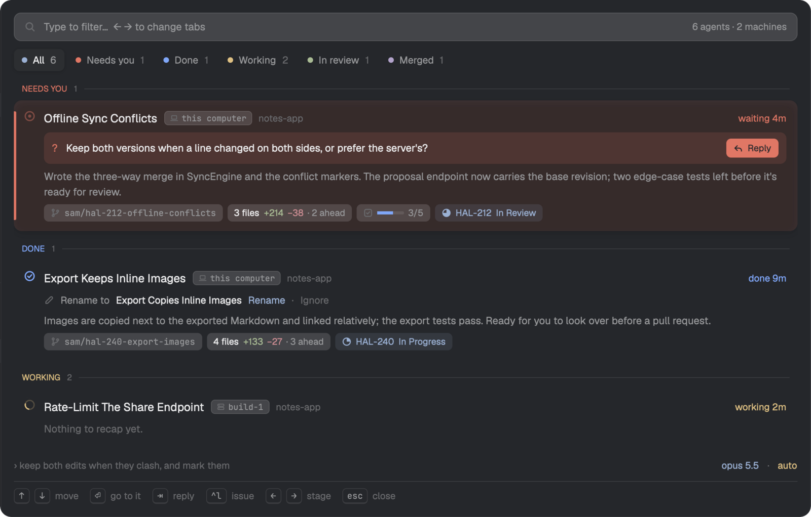

# Recap

Come back to a dozen agents and know in seconds which ones need you. Recap lists every agent on every machine Herdr is connected to, grouped by whose move it is, each with a one-line recap of where it got to, written in the background while you were away. Read the question a blocked agent is asking and reply right from the list, jump to any agent wherever it runs, and see its branch, unpushed work, tasks, pull request and Linear issue at a glance.

Starting agents is easy; coming back to them is the hard part: which one is
waiting on you, which finished, what each was even doing. Recap answers that
in one popup (⌘R) for every agent on every machine the Herdr app is connected
to:

- **Where each one got to,** in a sentence: Claude Code's own recap,
  written in the background while you're away, so it's ready when you look.
- **Whose move it is.** Needs you, done, needs fixing, working, in review,
  merged: the agents waiting on you come first, with the question they're
  asking right on the card.
- **Act without hunting for the terminal.** Reply to an agent from the
  popup, or press Enter to jump to it on whichever machine it runs.
- **Everything around the work at a glance:** its branch, uncommitted and
  unpushed changes, task progress, pull request and Linear issue.
- **Names that say what the work is.** Agents stuck with a slug for a title
  get a better one suggested, with their ticket's key, taken with a key.
- **Nothing else to install,** and cheap: a recap is only written when one
  is out of date, and shared with herdr-recap's TUI popup if you use both.

## What it is

A popup mod (`mod.json`: an overlay popup at the top, 80% of the window),
opened with ⌘R. It's the Herdr app's side of
[herdr-recap](https://github.com/mrolafsson/herdr-recap), which writes the
recaps.

## Installing it (for the agent adding it)

1. Copy `mods/recap/` to `~/.config/herdr-app/mods/recap/`.
2. Merge `keys.json` into the person's: add its sections and keys; ask
   before replacing a key they already bind to something else.
3. `herdr-app check ~/.config/herdr-app/mods/recap`.

**Already installed? That's an update, not a clash.** If
`mods/recap/` exists and is this mod (its `main.js` sets `RECAP_VERSION`
and fetches herdr-recap), replace its files with these, in place: don't
install a second copy under another name. Its keys are merged already;
step 2 only adds any new ones.

**A different mod named `recap`?** Then rename this one, and everything
that names it follows: the folder; `ICONS` in `look.js`
(`mods/<name>/icons`); in `keys.json`, the section `mod:recap` and every
action in it (`recap.reply`, `recap.rename`, `recap.ignore`,
`recap.escape`), and `mod.open:recap`. Missing any of them leaves Tab, Esc
or ⌘R doing the app's own thing instead.

That's all. **Don't install herdr-recap, or anything else, on any machine:**
the mod fetches the herdr-recap release it needs onto each machine with
agents by itself, the first time it looks there, and it does the same for
machines added later. What it needs there is already present: Claude Code
(the agents themselves), and `curl`, `tar` and `sha256sum` or `shasum`,
which macOS and Linux have.

Optional, for pull requests and Linear issues on the cards: herdr-github
and herdr-linear where the person is signed in to GitHub and Linear,
either fetched by their own app mods or in `~/.local/bin`. With the GitHub
mod (github.com/mrolafsson/herdr-github/tree/main/app) installed, a
pull request opens in it; with the Linear mod
(github.com/mrolafsson/herdr-linear/tree/main/app), an issue does. Mention them; don't install them unasked.

To see that it works: open it (⌘R). The first opening on a machine takes a
few seconds longer while herdr-recap is fetched; afterwards it's in
`~/.local/share/herdr-recap/app/<version>/` there, and recaps appear on the
cards (written in the background for agents that aren't working, so give
it a minute and open it again). A machine it couldn't reach, or couldn't
fetch herdr-recap onto, is named in a line under the list with why.

## What it does, and asks

- Lists `agents()` from every machine, grouped into stages: Needs you,
  Done, Needs fixing, Idle, Working, In review, Merged. Tabs for each, with
  counts; ← → move between them.
- For each machine with Claude Code agents, runs `herdr-recap sessions`
  there (through `exec(…, { on: machine })`) with the agents' Claude
  processes. It answers with each one's recap, a better title when its own
  is poor, its model, mode, last prompt, the question it's waiting on, its
  tasks, branch and git changes. Out-of-date recaps are written in the
  background by Claude Code's own `/recap`, in a fork of the session that's
  never saved.
- **Runs programs and reaches the network:** the first time it looks at a
  machine, it downloads the herdr-recap release it names (`RECAP_VERSION`
  in `main.js`) from GitHub for that machine, checks it against the
  release's `checksums.txt`, and keeps it in
  `~/.local/share/herdr-recap/app/<version>/`. It runs `hc` to read each
  agent's terminal, and `hc send` to type a reply into an agent.
- With herdr-github and herdr-linear where you're signed in (the copy
  their app mod fetched, else `~/.local/bin`), it shows each agent's pull
  request and Linear issue (`prs`, `issues`). With the GitHub or Linear
  mod installed, a pull request or issue opens in it (`openOverlay`,
  `back: "recap"`), else in the browser.
- Reads and writes `recap-cache.json` in the app's home, to show what it
  knew at once on opening.

## Its look

Colour only on state, from the theme's own roles (`blocked`, `working`,
`done`, `idle`, `accent`, the ANSI greens and magentas for PRs). Drawn icons
in `icons/`, 16px with a 1.6 stroke, tinted with the text colour: an arc that
spins while an agent works, a ring that breathes while it needs you. Cards
with a raised surface, a shadow and an edge in their stage's colour when
chosen; a question waiting is a callout with its own Reply; details are
chips. JetBrains Mono for branches, machines and keys.

## Keys (`keys.json`)

`cmd-r` opens it. In it: `tab` replies, `escape` leaves a reply before it
closes the popup, `ctrl-r` takes a suggested title, or asks for one now (`herdr-recap
title`, in the background), `ctrl-x` turns it down, and a click on the
chosen agent's title renames it to a title you type.
With herdr-teleport's Teleport mod installed too, `ctrl-t` moves the
chosen agent to another machine, in Teleport's popup (`esc` there comes
back here).
`recap.demo` (with `herdr-app do`, while it's open) switches to made-up
agents for that opening.
